  

 

  <table border="0" cellspacing="0" cellpadding="6">
    <tr>
      <td valign="top" align="center">
        
      </td>
      <td valign="top" align="center">
        
      </td>
    </tr>
  </table>

 

  

 

  
  

